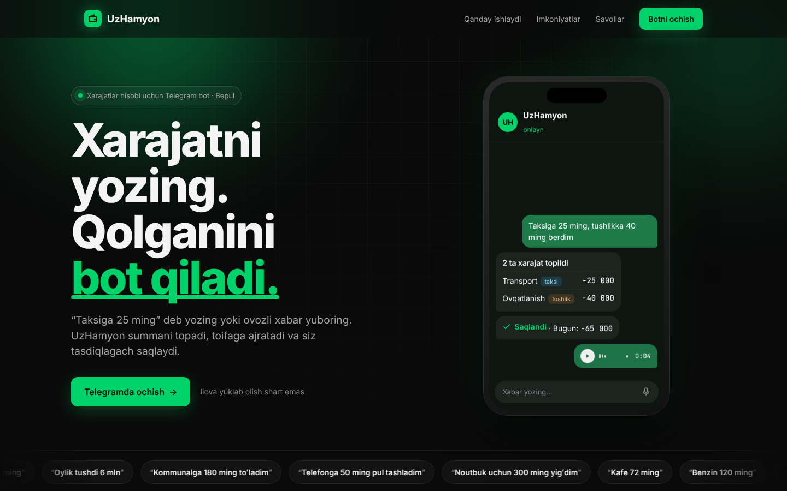
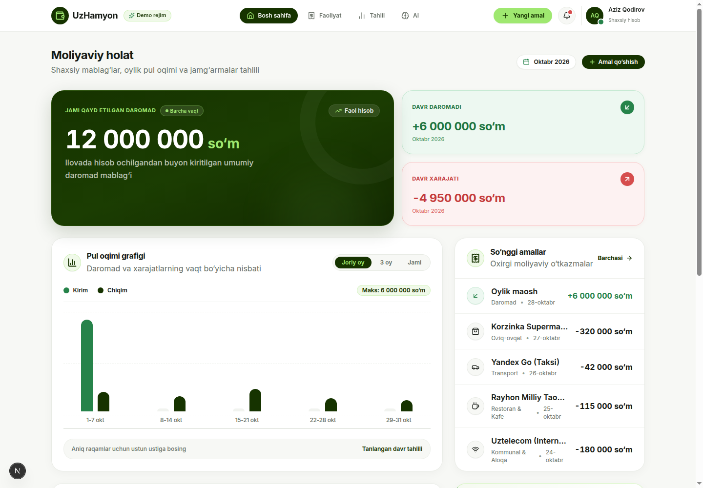
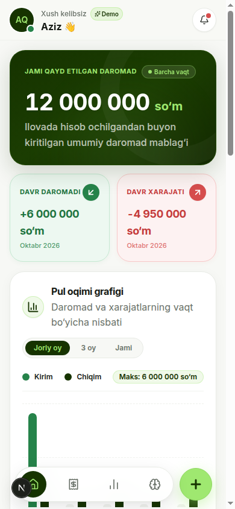
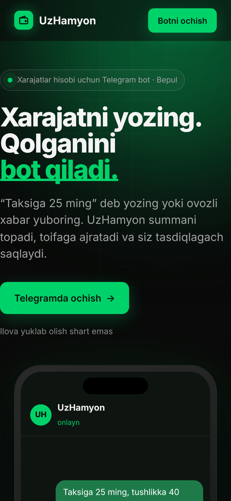
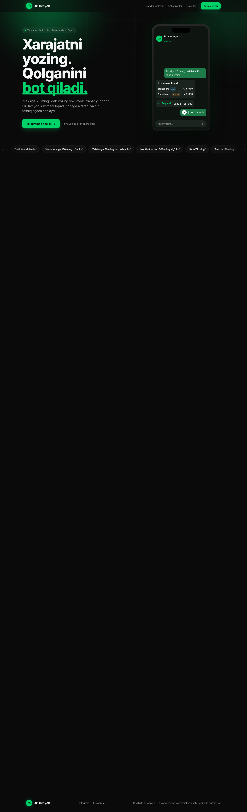
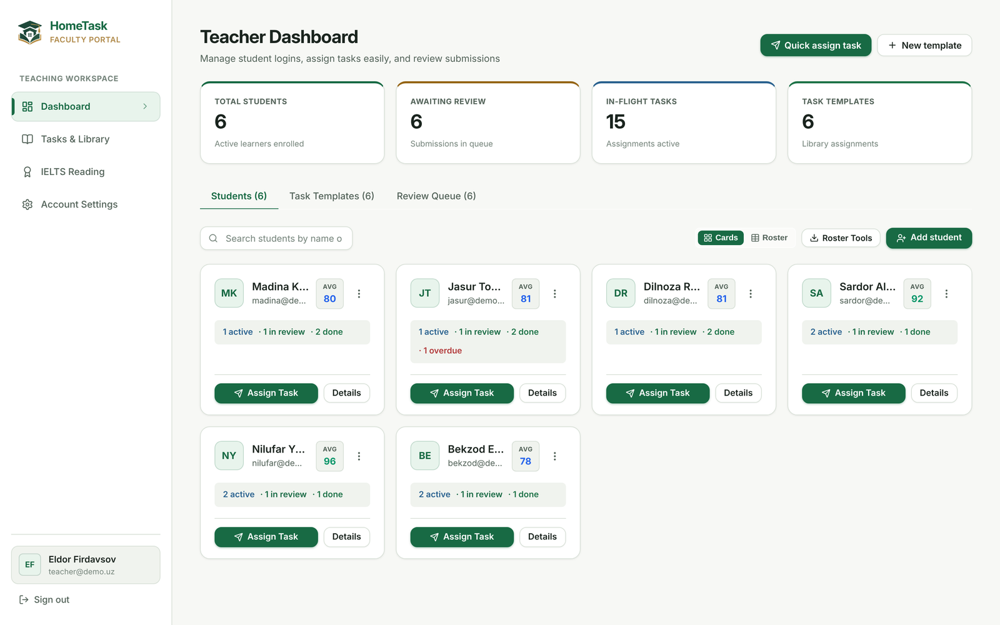
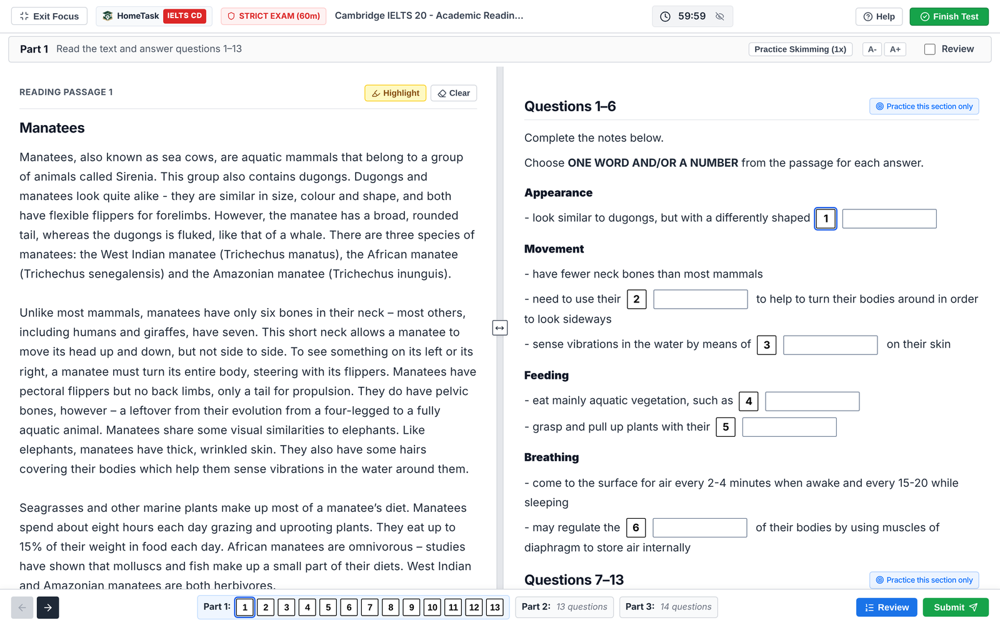
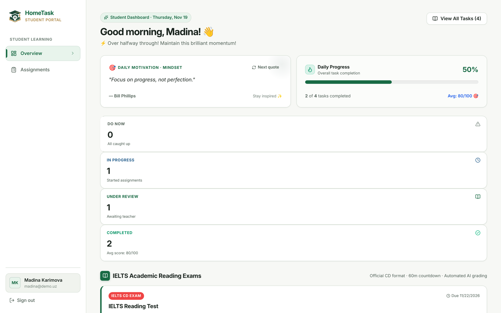
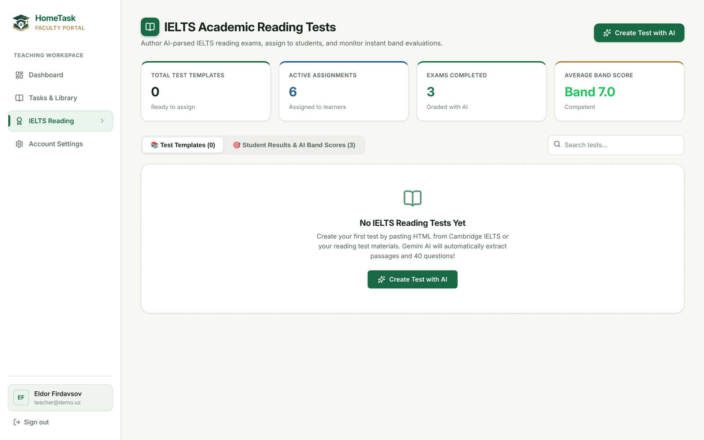
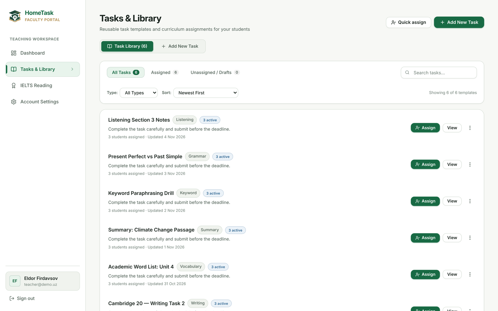

<h1 align="center">Hi 👋, I'm Eldor Firdavsov</h1>
<h3 align="center">A passionate frontend developer from Uzbekistan</h3>

  

  

- 🌱 I’m currently learning **Frontend, AI/ML**

- 👨‍💻 All of my projects are available at [eldordev.vercel.app](eldordev.vercel.app)

- 💬 Ask me about **React, TailwindCSS, Python**

- 📫 How to reach me **firdavsove1@gmail.com**

- 📄 Know about my experiences [https://drive.google.com/file/d/1o3xxrO-pg8NLsKgYDUpjBvJafp8-aL4S/view?usp=sharing](https://drive.google.com/file/d/1o3xxrO-pg8NLsKgYDUpjBvJafp8-aL4S/view?usp=sharing)

- ⚡ Fun fact **I am a rapid learner**

<h2 align="left">🚀 Featured Projects</h2>

<!-- ───────────────────────── UzHamyon ───────────────────────── -->
<table>
<tr>
<td width="110" valign="top">

</td>
<td valign="top">

### UzHamyon — AI expense tracker in Telegram

Write *“Taksiga 25 ming, tushlikka 40 ming berdim”* or just send a voice message — the bot finds the amounts, sorts them into categories, and saves them once you confirm. A Telegram Mini App shows your balance, cash-flow charts and AI insights.

</td>
</tr>
</table>

☝️ The live landing page — <a href="https://uzhamyon-landing.vercel.app/">uzhamyon-landing.vercel.app</a>

<table>
<tr>
<td width="62%"></td>
<td width="19%"></td>
<td width="19%"></td>
</tr>
<tr>
<td align="center">Mini App dashboard</td>
<td align="center">Mini App · mobile</td>
<td align="center">Landing · mobile</td>
</tr>
</table>

<b>📜 See the full UzHamyon landing page</b>

 

 

<!-- ───────────────────────── HomeTask ───────────────────────── -->
<table>
<tr>
<td width="110" valign="top">

</td>
<td valign="top">

### HomeTask — homework & IELTS academic platform

A teacher/student portal for homework: teachers manage students, build a task library, assign work and review submissions. It also includes a **computer-delivered IELTS Academic Reading exam simulator** — paste a test's HTML, Gemini AI extracts the passages and 40 questions, and students take a timed exam with automatic band scoring.

</td>
</tr>
</table>

<table>
<tr>
<td width="50%"></td>
<td width="50%"></td>
</tr>
<tr>
<td align="center">IELTS CD reading exam with live timer</td>
<td align="center">Student dashboard</td>
</tr>
<tr>
<td width="50%"></td>
<td width="50%"></td>
</tr>
<tr>
<td align="center">AI-graded IELTS reading tests</td>
<td align="center">Tasks &amp; library</td>
</tr>
</table>

HomeTask screenshots use demo data.

<h3 align="left">Connect with me:</h3>

<h3 align="left">Languages and Tools:</h3>

           

